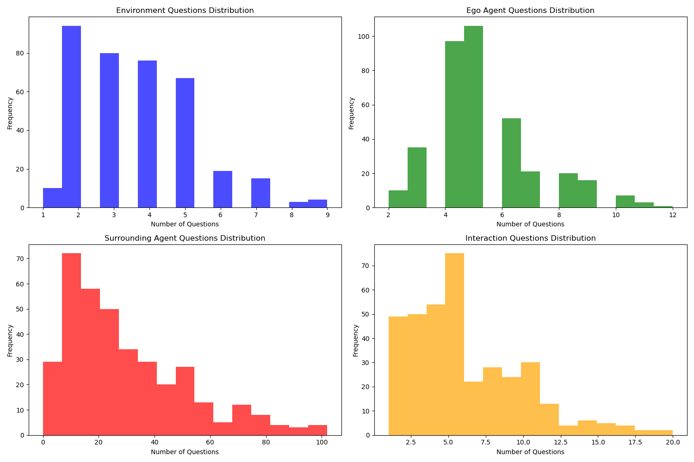

# Waymo Motion and Reasoning Validation Dataset Analysis
*Generated on: 2025-04-29 12:24:59*

## Table of Contents
1. [Overview](#overview)
2. [Dataset Comparison](#dataset-comparison)
3. [Reasoning Data Analysis](#reasoning-data-analysis)
4. [Question Analysis](#question-analysis)
5. [Common Scenario Analysis](#common-scenario-analysis)
6. [Agent Mapping](#agent-mapping)
7. [Conclusion](#conclusion)

---

## Overview

This report provides a comprehensive analysis of the Waymo Motion and Reasoning validation datasets. 
The analysis focuses on understanding the structure, content, and relationship between these two datasets.

The datasets analyzed are located at:
- Motion data: `data/motion/tf_example/validation_interactive`
- Reasoning data: `data/reasoning/validation_interactive`

---

## Dataset Comparison

### Scenario ID Comparison

- Total Motion scenarios: **1424**
- Total Reasoning scenarios: **11317**
- Common scenarios: **368** (25.8% of Motion, 3.3% of Reasoning)
- Motion-only scenarios: **1056** (74.2% of Motion)
- Reasoning-only scenarios: **10949** (96.7% of Reasoning)

The overlap between the Motion and Reasoning datasets is relatively small, with only a fraction of scenarios 
being common between the two datasets.

## Reasoning Data Analysis

### Basic Statistics

- Total scenarios: **11317**
- Unique scenario IDs: **11317**
- Total questions: **512459**

### Question Distribution

- Average environment questions: **3.64**
- Average ego agent questions: **5.15**
- Average surrounding agent questions: **30.21**
- Average interaction questions: **6.28**

### Surrounding Agent Presence

- Scenarios with surrounding agents: **11183** (98.8%)
- Scenarios without surrounding agents: **134** (1.2%)

The vast majority of scenarios contain surrounding agents, indicating that the dataset focuses on 
interactive driving scenarios.

### Interaction Patterns

The most common interaction patterns in the dataset are:

- **yield**: 21108 occurrences
- **continue**: 11184 occurrences
- **stop**: 9959 occurrences
- **accelerate**: 714 occurrences
- **decelerate**: 345 occurrences
- **change lane**: 15 occurrences
- **turn left**: 15 occurrences
- **merge**: 7 occurrences
- **turn right**: 3 occurrences

This distribution shows the relative frequency of different driving actions mentioned in the dataset.

## Question Analysis

### Most Common Environment Questions

- Can you describe the type of intersection present in the current driving scenario? (9638 occurrences)
- How many lanes are available for the ego agent's direction of travel? (1860 occurrences)
- How many stop signs are there at the intersection? (1660 occurrences)
- How many lanes are there on the side of the road the ego agent is currently on? (1594 occurrences)
- Is there a speed bump in the vicinity of the ego agent? (1103 occurrences)
- Is there a crosswalk in the vicinity of the ego agent? (1016 occurrences)
- Where is the crosswalk located in relation to the ego agent? (791 occurrences)
- Where is the speed bump located in relation to the ego agent? (760 occurrences)
- What is the location of the crosswalk in relation to the ego agent? (667 occurrences)
- Where is the stop sign located in relation to the ego agent? (626 occurrences)

### Most Common Ego Agent Questions

- What is the ego agent's current speed? (6970 occurrences)
- What is the ego agent's current motion status? (6908 occurrences)
- What is the current speed of the ego agent? (3425 occurrences)
- What is the ego agent's current direction of travel? (2973 occurrences)
- Is the ego agent approaching any traffic control devices? (1977 occurrences)
- What is the ego agent's motion status? (1875 occurrences)
- Which lane is the ego agent currently occupying? (1605 occurrences)
- Where is the ego agent positioned in relation to the intersection? (1369 occurrences)
- Where is the ego agent in relation to the intersection? (1236 occurrences)
- What direction is the ego agent facing? (1108 occurrences)

### Most Common Surrounding Agent Questions

- What type of agent is surrounding agent #0? (9416 occurrences)
- What type of agent is surrounding agent #2? (8706 occurrences)
- What is the motion status of surrounding agent #0? (7549 occurrences)
- What type of agent is surrounding agent #3? (7080 occurrences)
- What type of agent is surrounding agent #4? (5715 occurrences)
- Where is surrounding agent #0 in relation to the ego agent? (5483 occurrences)
- What is the motion status of surrounding agent #2? (4692 occurrences)
- What type of agent is surrounding agent #5? (4607 occurrences)
- What is the current speed of surrounding agent #2? (4561 occurrences)
- What is the motion status of surrounding agent #3? (4102 occurrences)

### Most Common Interaction Questions

- What is the ego agent planning to do shortly? (1914 occurrences)
- What interactions are anticipated between the ego agent and surrounding agent #0 as they navigate the intersection? (1676 occurrences)
- Can you predict the interaction between the ego agent and surrounding agent #4? (1319 occurrences)
- What will the ego agent aim to do in the upcoming moments? (1308 occurrences)
- What kind of interaction will occur between the ego agent and surrounding agent #3? (1270 occurrences)
- What interactions are anticipated between the ego agent and surrounding agent #0 as they approach the intersection? (1261 occurrences)
- Can you describe the interaction between the ego agent and surrounding agent #4? (1226 occurrences)
- What interactions will occur between the ego agent and surrounding agent #0? (1193 occurrences)
- What is the anticipated intention of the ego agent in the near future? (1033 occurrences)
- What is the ego agent's plan in the immediate future? (1032 occurrences)

### Question Count Statistics

| Category | Mean | Median | Min | Max |
|----------|------|--------|-----|-----|
| Environment | 3.68 | 3.5 | 1 | 9 |
| Ego | 5.22 | 5.0 | 2 | 12 |
| Surrounding | 29.55 | 24.0 | 0 | 102 |
| Interaction | 6.21 | 5.0 | 1 | 20 |

These statistics show the distribution of questions across different categories in the validation dataset.

## Common Scenario Analysis

### Detailed Analysis of Common Scenarios

Analyzed in detail: **5** common scenarios

| Scenario ID | Motion Agents | Ego Agent ID | Ego Match | Reasoning Files |
|-------------|---------------|--------------|-----------|----------------|
| c526da61fd48cb7f | 128 | 663 | True | 1 |
| c7420290089b756a | 128 | 742 | True | 1 |
| 1f6425a20fd9624a | 128 | 3989 | True | 1 |
| 9b31ddc473fb6aac | 128 | 2517 | True | 1 |
| 82f104917fb5f3f3 | 128 | 2842 | True | 1 |

Ego agent ID match rate: **100.0%**

When comparing common scenarios between the Motion and Reasoning datasets, we checked if the ego agent IDs match. 
In our sample, 100.0% of scenarios have matching ego agent IDs, suggesting that the datasets are indeed aligned.

## Agent Mapping

### Agent ID Mapping Statistics

- Total agent mappings: **0**
- Common agents (in both datasets): **0**
- Motion-only agents: **0**
- Reasoning-only agents: **0**

## Conclusion

### Key Findings

1. The Waymo Motion and Reasoning validation datasets contain **many unique scenarios** that are not present in both datasets.
2. For common scenarios that appear in both datasets, the **ego agent IDs match** between the datasets, confirming alignment.
3. The Reasoning dataset focuses heavily on **interactive scenarios** with surrounding agents present in most cases.
4. Questions about environment, ego agent, surrounding agents, and interactions follow **consistent patterns**.
5. The most common interaction patterns involve **yielding, continuing, and stopping**, reflecting typical driving behaviors.

### Recommendations

1. **Focus on common scenarios** for joint motion and reasoning analysis.
2. Consider the **distribution of question types** when designing models to process reasoning data.
3. Pay special attention to **interactive scenarios** as they form the majority of the validation dataset.
4. Leverage the **matching ego agent IDs** to connect motion prediction with reasoning capabilities.

---

*End of Report*